# SentinelASM Architecture

## System Modules

- Identity: registration, login, JWT session management, password hashing, user profile, API key.
- Scan Orchestration: creates scan jobs, returns immediately, runs work asynchronously, stores logs, and exposes SSE progress events.
- Recon Engine: black-box SubMerge integration that consumes `output/<domain>/final/alive.txt`, `resolved.txt`, and `run.log`.
- Scanner Modules: `ScannerModule` implementations are ordered and executed by `ScanOrchestrator`.
- Asset Inventory: normalized assets, response codes, page titles, technologies, ports, screenshots, and last-seen data.
- Vulnerability Management: normalized findings, severity, CVE/CVSS fields, status workflow, and recommendations.
- Risk Engine: weighted scoring by severity for scan, domain, and asset-level prioritization.
- Reporting: JSON/CSV exports now, with PDF and Excel extension points.
- Notifications: in-app notifications now, with environment hooks for email, Slack, Discord, Telegram.
- UI: premium React dashboard with charts, scan history, live logs, filters, exports, and responsive layouts.

## Data Ownership

Every user-owned table includes an `owner` relation. API controllers only query through the authenticated user, so analysts cannot read each other's scans or assets.

## Scan Lifecycle

```mermaid
flowchart LR
  A["User creates authorized scan"] --> B["Scan queued"]
  B --> C["Async scan worker"]
  C --> D["SubMerge black-box recon"]
  D --> E["Import alive.txt and resolved.txt"]
  E --> F["Nmap open ports"]
  F --> G["WhatWeb technologies"]
  G --> H["Headers, screenshots, WHOIS, SSL, directory, API modules"]
  H --> I["Nuclei findings"]
  I --> J["Risk scoring"]
  J --> K["Persist assets, ports, findings"]
  K --> L["Generate reports and notify analyst"]
```

## Production Hardening Backlog

- Move async jobs to Redis/RabbitMQ with worker replicas.
- Add refresh tokens, MFA, account lockout, and audit logs.
- Replace `ddl-auto=update` with Flyway migrations.
- Add Playwright screenshot capture service.
- Implement PDF/Excel exports with branded templates.
- Add rate limiting and tenant-aware organization model.
- Add WebSocket/SSE scan log streaming.
